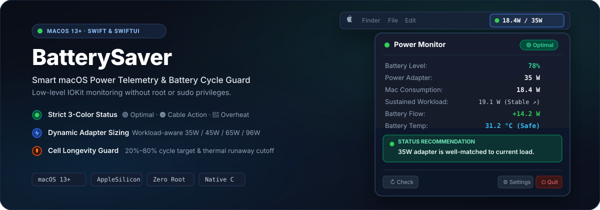
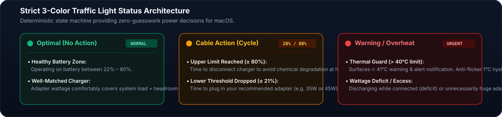
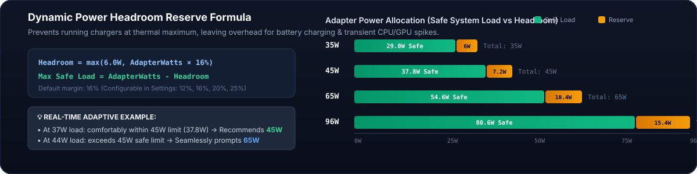

<p align="center">
  
</p>

<p align="center">
  <a href="https://swift.org"></a>
  <a href="https://developer.apple.com/macos/"></a>
  <a href="https://developer.apple.com/xcode/swiftui/"></a>
  <a href="#-architecture--native-telemetry"></a>
  <a href="#-license"></a>
</p>

---

## ⚡️ Overview

**BatterySaver** is a lightweight, zero-privilege macOS Menu Bar utility designed to protect MacBook batteries from chemical degradation, thermal runaway, and suboptimal USB-C charging.

Operating directly on raw hardware telemetry from Apple Silicon and Intel power controllers via IOKit, BatterySaver guides you through a healthy **20% – 80%** battery cycle, surfaces thermal stress alerts in real time, and dynamically determines the exact USB-C adapter capacity (e.g. 35W, 45W, 65W, 96W, 140W) required by your current workload.

---

## 🚦 Three-Tier Status Indicator

BatterySaver eliminates ambiguity with a deterministic 3-color status indicator in your menu bar and HUD:

<p align="center">
  
</p>

| State | Status | Meaning | Trigger Condition |
|:---:|:---:|---|---|
| 🟢 | **Optimal** | **No action required** | • Running on battery within the healthy zone (22% – 80%).<br>• Connected power adapter covers current system consumption plus safety reserve margin. |
| 🟠 | **Cable Action** | **Connect or disconnect cable** | • Battery reached **≥ 80%** $\implies$ Disconnect charger to eliminate high-voltage dwell degradation.<br>• Battery dropped to **≤ 21%** (on battery) $\implies$ Connect recommended adapter (e.g. 35W or 45W) to prevent deep discharge. |
| 🔴 | **Action Required** | **Thermal alert or power mismatch** | • **Thermal Alert:** Battery temperature exceeds safety limit (default **40°C**). Surfaces `🔥 temp` in menu bar with a 1°C anti-flicker hysteresis.<br>• **Power Deficit:** System discharges under heavy load while connected to power (net flow $< -1.0\text{W}$).<br>• **Power Excess:** Connected to an oversized adapter while system workload fits safely on a lighter charger. |

---

## 📐 Power Headroom Reserve & Dynamic Sizing

Connecting a charger that runs near 100% capacity produces excessive heat and throttles charging performance. BatterySaver computes the exact adapter required using a dynamic headroom margin formula:

$$\text{Required Headroom} = \max\left(6.0\text{W},\, \text{Adapter Watts} \times \text{Margin\%}\right)$$
$$\text{Max Safe Load} = \text{Adapter Watts} - \text{Required Headroom}$$

<p align="center">
  
</p>

With the default **16% safety margin** (configurable to 12%, 16%, 20%, or 25%):

- **35W Adapter:** Handles workloads up to **29.0W** ($6.0\text{W}$ reserve).
- **45W Adapter:** Handles workloads up to **37.8W** ($7.2\text{W}$ reserve).
  - *Scenario A:* Running at **37W workload** $\implies$ comfortably fits in 45W $\implies$ recommends **45W**.
  - *Scenario B:* Heavy build at **44W workload** $\implies$ exceeds safe limit $\implies$ seamlessly steps up to **65W**.
- **65W Adapter:** Handles workloads up to **54.6W** ($10.4\text{W}$ reserve).
- **96W Adapter:** Handles workloads up to **80.6W** ($15.4\text{W}$ reserve).
- **140W Adapter:** Handles workloads up to **117.6W** ($22.4\text{W}$ reserve).

---

## 🌡️ Battery Temperature & Thermal Protection

Lithium-ion cells degrade rapidly when operated or charged at temperatures exceeding $40^\circ\text{C}$. BatterySaver monitors internal cell sensors directly through `AppleSmartBattery`:

- **Real-Time Sampling:** Polled every 3 seconds for immediate thermal awareness.
- **Configurable Limit:** Adjustable between $30^\circ\text{C}$ and $60^\circ\text{C}$ (default: **$40^\circ\text{C}$**).
- **1°C Anti-Flicker Hysteresis:** The overheat alert requires cooling down to at least $1^\circ\text{C}$ below the trigger point before resetting, preventing notification spam.
- **Emergency Menu Bar Override:** Regardless of your chosen menu bar layout, an overheating event immediately turns the indicator **RED 🔴** and surfaces `🔥 41.2°C`.

---

## 💻 Menu Bar Customization

Choose between **8 display formats** and **3 icon styles** to fit your desktop style:

```text
1. Smart (Recommended):  [🟢] 18W / 35W  (On Power)  |  [🟢] 35W  (On Battery)
2. Full:                 [🟢] 18W / 35W  (On Power)  |  [🟢] 18W | 35W  (On Battery)
3. Mac Consumption:      [🟢] 18W
4. Target Adapter:       [🟢] 35W
5. Battery Percentage:   [🟢] 78%
6. Battery Temperature:  [🟢] 31.0°C
7. Battery % & Temp:     [🟢] 78% • 31°C
8. Minimalist Icon Only: [🟢]
```

Icon options: **Status Dot (🟢)**, **Lightning Bolt (⚡️)**, or **Battery with Bolt (🔋)**.

---

## 🚀 Quick Start

### 1. One-Click Build & Install

Run the included automated build script:

```bash
# Build and run immediately
./build_app.sh --run

# Or install directly into /Applications
./build_app.sh --install
```

### 2. Xcode

1. Open `BatterySaver.xcodeproj`.
2. Select target `BatterySaver` with destination `My Mac`.
3. Press `Cmd + R` to build and run.

### 3. Swift CLI

```bash
swift run -c release BatterySaver
```

---

## ⚙️ Settings & Configuration

Click the menu bar icon and select **Settings...** (`⌘,`):

| Setting | Options / Defaults | Description |
|---|---|---|
| **Display Format** | Smart (Default), Full, Consumption, Adapter, Battery %, Temp, Icon | Customizes the menu bar readout with a live preview. |
| **Icon Style** | Status Dot, Lightning Bolt, Battery with Bolt | Chooses the visual glyph preceding metrics. |
| **Available Adapters** | 20W, 30W, 35W, 45W, 60W, 65W, 96W, 140W (Customizable) | Select only the adapters you own so recommendations remain practical. |
| **Cycle Boundaries** | 20% Minimum / 80% Maximum (Customizable) | Defines the trigger thresholds for the Orange cable alert. |
| **Thermal Protection** | 30°C – 60°C (Default 40°C) | Configures the threshold for red thermal warnings. |
| **Power Headroom** | 12%, 16% (Default), 20%, 25% | Sets the safety reserve percentage for adapter sizing. |
| **Sensor Polling** | 15s, 30s (Balanced), 60s, 120s | Polling frequency. Hardware plug/unplug events update instantly via IOKit. |
| **Launch at Login** | Enabled / Disabled | Seamless native autostart via macOS `SMAppService`. |

---

## 🔬 Architecture & Native Telemetry

BatterySaver runs completely unprivileged (**zero root / sudo**):

- **IOKit Power Source Notifications:** Subscribes to `IOPSNotificationCreateRunLoopSource` for event-driven updates whenever a power cable is plugged or unplugged.
- **AppleSmartBattery Registry:** Reads direct telemetry keys (`PowerTelemetryData`, `SystemLoad`, `BatteryPower`, `AdapterDetails`, `InstantAmperage`, `Voltage`, `Temperature`, `VirtualTemperature`).
- **Trend Stabilization Engine:** Evaluates moving load averages with stabilization dwell times before recommending a step-up or step-down in charger wattage, preventing rapid oscillation during bursty tasks.

---

<p align="center">
  <a href="https://github.com/oil-oil/beautify-github-readme"></a>
</p>

## 🛡 License

Copyright © 2026 Qrappa inc. All rights reserved.
